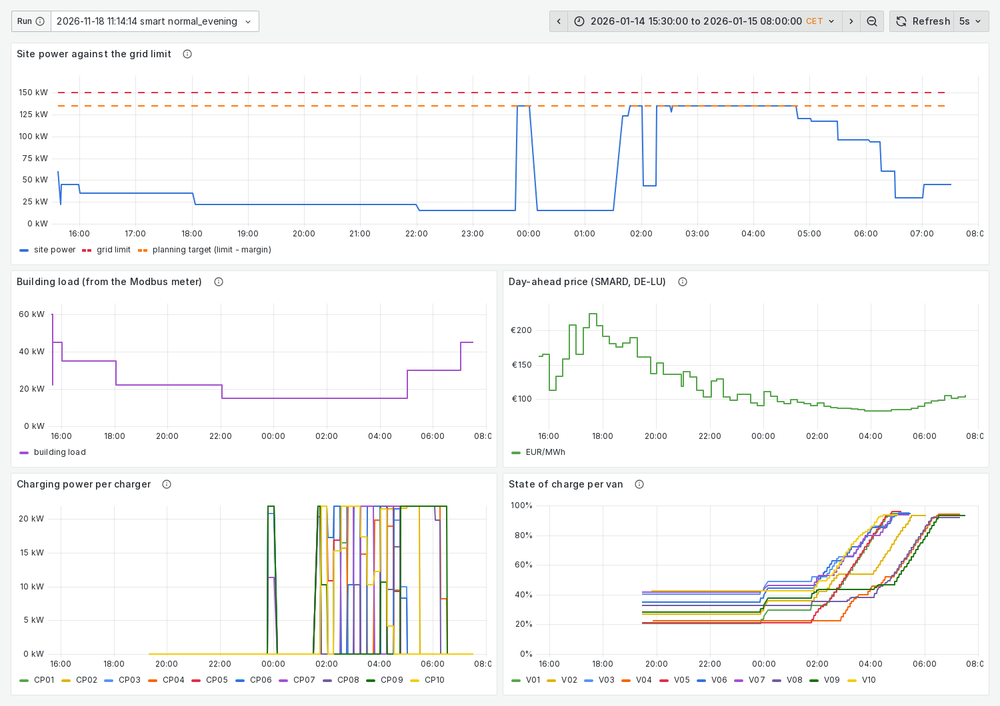
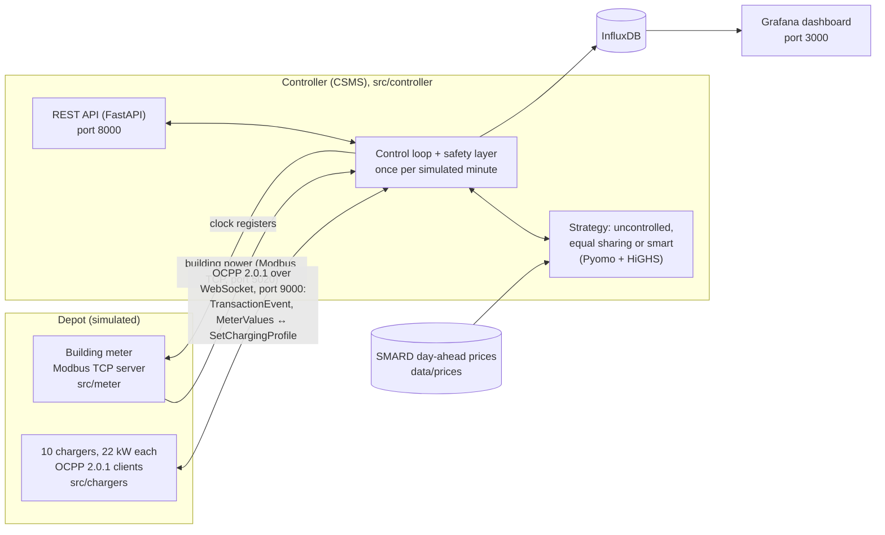
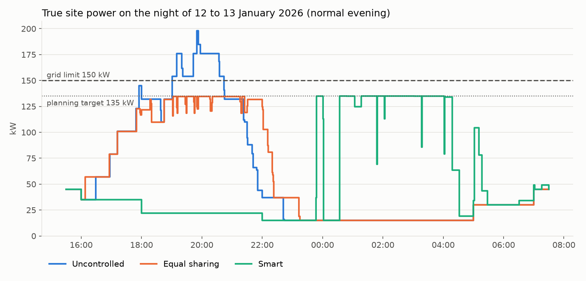
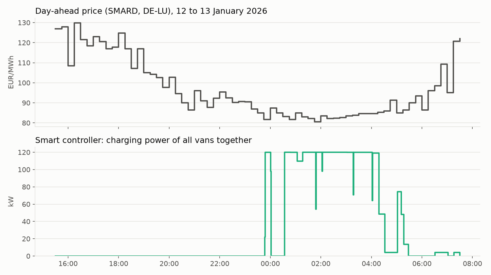
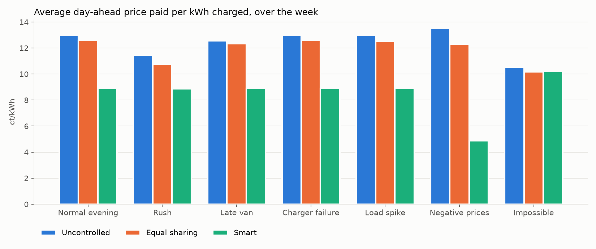
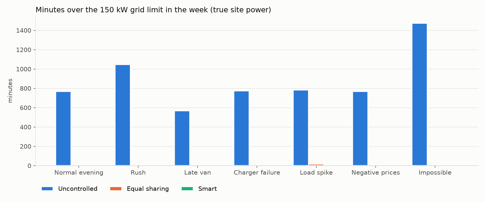

# Depot_Charging_Controller

[](https://github.com/abdulrehman0306/Depot_Charging_Controller/actions/workflows/tests.yml)

Software that charges a fleet of electric delivery vans overnight: every van ready on time, the depot never over its grid connection limit, and the electricity as cheap as possible.



*One night of the smart controller in the Docker setup (14 to 15 January 2026, real day-ahead prices). The vans wait through the expensive evening and charge after midnight, up to the 135 kW planning target, never over the 150 kW limit.*

## 1. What it does

A central controller (a CSMS, "charging station management system") talks to ten simulated 22 kW chargers over **OCPP 2.0.1** and reads a simulated building energy meter over **Modbus TCP**. Once per simulated minute it decides how much current every charger may give, and sends it as a charging profile. It can do that in three ways (uncontrolled, equal sharing, and a smart controller that optimises against real German day-ahead prices), so they can be compared on the same nights.

Everything runs as separate programs connected over real network protocols, starts with one `docker compose up`, stores every measurement in InfluxDB, shows them in Grafana, and has a REST API to watch the site and change the grid limit while it runs.

## 2. The problem

A delivery depot has 10 vans and 10 chargers of 22 kW each. The vans come back in the afternoon and evening and leave the next morning, and each must leave with at least 90 % charge.

- **The grid connection is 150 kW**, and that includes the building (offices, lights, workshop, 15 to 45 kW). Ten chargers at full power would draw 220 kW plus the building. Without control the depot goes far over its limit every evening, which in reality means a tripped main breaker or expensive peak charges.
- **The price changes every quarter hour.** On the German day-ahead market of 14 January 2026 a MWh cost 224.16 EUR at 17:30 and 82.36 EUR at 04:15 the next morning; 17:00 to 20:00 averaged 180.38 EUR/MWh, 01:00 to 05:00 only 86.89. A van that is plugged in at 18:00 and leaves at 07:00 does not need to charge at 18:00.
- **The controller cannot see everything at once.** The building meter is read once a minute, so a sudden rise in building load is seen up to a minute late; chargers report their power every few minutes; a charger can lose its connection.

## 3. System diagram



- **OCPP messages used**: BootNotification, Heartbeat, StatusNotification, TransactionEvent (with the van's RFID card as idToken), MeterValues, SetChargingProfile (TxProfile and TxDefaultProfile). Built with the `ocpp` Python library by The Mobility House.
- **Amps at the edge**: all planning is in kW; limits are sent to the chargers in amps per phase (3 x 230 V, 32 A = 22 kW), rounded down to 0.1 A, in one function (`src/electrical.py`). Following IEC 61851-1 a charger is never given a limit between 0 and 6 A: below 6 A the van pauses (0 A).
- **Modbus register map** (`src/meter/registers.py`): power, voltages, currents, frequency and an energy counter as 32 bit values over two 16 bit registers, high word first, in the style of common industrial meters (not a copy of a real meter's map).
- **One simulated clock**: the controller owns it. Chargers set their clocks from the `currentTime` in the controller's BootNotification and Heartbeat answers; the meter follows the time the controller writes into its clock registers (20-21). So the whole system can run a night 60 to 3000 times faster than real time.

## 4. How to run

### With Docker: the whole system with one command

Needs Docker Desktop. First create the secrets file (it is in `.gitignore`; only `.env.example` with placeholders is in the repository):

```
copy .env.example .env
```

and replace every `change-me` value in `.env` with your own (for the token, a long random text). Then:

```
docker compose up -d
```

This builds one image for the three Python programs and starts the containers in order, each waiting until the ones it needs are healthy:

| Container | What it is | Where to look |
|---|---|---|
| `influxdb` | the database | http://localhost:8086 |
| `meter` | the simulated building meter (Modbus TCP) | |
| `controller` | the CSMS with the control loop and the REST API | http://localhost:8000/docs |
| `chargers` | the ten simulated chargers; this container stops when the last van has left | `docker compose logs chargers` |
| `grafana` | the dashboard (login: `GRAFANA_ADMIN_USER` and `GRAFANA_ADMIN_PASSWORD` from `.env`) | http://localhost:3000 |

By default the smart controller runs the normal scenario at 60 times real time, so a night takes about 16 minutes. To choose for one start, in PowerShell:

```
$env:SIM_SPEED="600"; $env:SCENARIO="load_spike"; $env:STRATEGY="equal_sharing"; docker compose up -d
```

(or set them in `.env`). Scenarios: `normal_evening`, `rush`, `late_van`, `charger_failure`, `load_spike`, `negative_prices`, `impossible`. Strategies: `uncontrolled`, `equal_sharing`, `smart`. `docker compose down` stops everything; the data stays in the volumes.

Checked on a fresh run for this README: a smart night of the normal scenario at 600 times real time. The chargers container finished with exit code 0, all ten vans left with 92.1 to 95.8 %, the controller reported a peak of 135.0 kW at 01:47, 0 minutes over the limit, 0 safety actions, and 54 plans with none needing the fallback rule. The image is 706 MB; `.env` is kept out of it by `.dockerignore`, and the secrets reach the containers as environment variables.

### The dashboard

`grafana/dashboards/depot_charging.json` has five panels: site power against the grid limit and the planning target, building load, day-ahead price, charging power per charger, and state of charge per van. A drop-down at the top chooses the run. Grafana loads the dashboard and the InfluxDB data source by itself at start-up from `grafana/provisioning/`; the data source file holds no secrets, the token comes from the environment. The default time range is the normal night (14 to 15 January 2026); for `negative_prices` choose 4 to 5 October 2025.

The screenshot at the top was made by Grafana's image renderer, an extra container that only starts with a profile:

```
docker compose --profile screenshot up -d
python -m src.dashboard_screenshot
```

### The REST API

| Endpoint | What it does |
|---|---|
| `GET /status` | the site now: simulated time, strategy, limit, planning target, building, charging and site power |
| `GET /chargers` | every charger: connected or not, van, power, allowed power, state of charge |
| `GET /vans` | every plugged-in van: charger, state of charge, departure time, the smart controller's forecast shortfall |
| `PUT /site-limit` | change the grid limit, e.g. `{"site_limit_kw": 120}`, between 20 and 400 kW |

A new limit is used from the next control cycle. In a live run (equal sharing, simulation speed 600) the limit was lowered from 150 to 100 kW at 19:36 while the site drew 134.6 kW; the next cycle cut charging, at 19:38:41 the site was back under 100 kW, and at 19:45 it drew 84.8 kW, just under the new 85 kW target. A request for 5 kW is refused with HTTP 422.

### Without Docker, for development

```
python -m venv .venv
.venv\Scripts\activate
pip install -r requirements.txt
docker compose up -d influxdb grafana
```

then three programs in three terminals, in this order (set `$env:SIM_SPEED`, `$env:SCENARIO`, `$env:STRATEGY` the same way in each, if wanted):

```
python -m src.meter.modbus_meter
python -m src.controller.run_controller
python -m src.chargers.run_chargers
```

### The results and the tests

```
python -m src.run_week                 every scenario x strategy x 7 nights -> results/nights.csv (84 minutes here)
python -m src.results                  tables and charts from results/nights.csv
python -m src.measure_spike_reaction   the load spike reaction at a slow speed -> results/spike_reaction.csv
python -m pytest -m "not night"        quick tests
python -m pytest                       all tests, including complete simulated nights
```

GitHub Actions runs all tests on every push, the quick tests and the night tests as two jobs on a fresh Linux machine (`.github/workflows/tests.yml`).

## 5. The strategies in simple words

- **Uncontrolled**: no software. Every van charges at 22 kW from plug-in until it is full. This is the baseline: what happens if nobody manages the chargers.
- **Equal sharing**: the controller shares what is left under the limit equally between the vans that still want power:

  available for charging = grid limit (150 kW) - safety margin (15 kW) - building load (from the meter)

  Because of the 6 A rule a van gets either 0 or at least 4.14 kW. If there is not enough for everyone, the vans at the front of a queue charge and the others pause; every 15 minutes the queue rotates, so no van waits all night. It keeps the limit but ignores prices.
- **Smart**: every quarter hour the controller plans each van's charging until it leaves, with a small optimisation model (Pyomo, solved by HiGHS, `src/controller/smart_planner.py`). The question it answers: *how much power should each van get in each quarter hour, so that every van reaches 90 % before it leaves, the site stays under the limit, and the electricity is as cheap as possible?*
  - It must respect: the available power in each quarter hour (135 kW minus the expected building load), at most 21.94 kW per charger, no battery above 100 %, and the 6 A rule for the quarter hour that is sent now.
  - It minimises, in this order: energy missing at departure (110 to 200 EUR per kWh by van priority, far above any electricity price, so it charges every van it can before it looks at prices); energy still missing 30 minutes before departure (so a small delay at the end cannot leave a van short); and the cost at the day-ahead price.
  - Only the first quarter hour is sent; the next quarter hour it plans again with fresh data (a rolling horizon). It aims at 92 % so rounding losses cannot leave a van below 90 %. If the solver fails, a simple rule takes over for that quarter hour: the van that can least afford to wait first.
  - When not every van can make it, it serves vans in a fixed order: the one leaving first, then the one that came back emptiest. It reports which vans will be short, hours before they leave.

### The safety layer (equal sharing and smart)

The controller runs a control cycle once per simulated minute, like a PLC cyclic task:

1. Read the building load from the meter.
2. Estimate the site power: the meter value, plus for every charging van the higher of what it last reported over OCPP and what the controller has allowed it. So a change the controller made itself is counted at once, without waiting for the meter.
3. If the estimate is above the planning target, cut charging now. Otherwise plan again at each quarter hour or when a van arrives, fills up or leaves.

More rules: a newly plugged-in van starts at 0 A (a TxDefaultProfile sent at boot) until the controller gives it a share; reductions are sent first, to all chargers at once, and increases only after the reduced chargers have confirmed; a charger that loses its connection keeps its last limit (OCPP 2.0.1 behaviour), and the controller keeps its power reserved until it is back.

**Why a 15 kW margin.** The building load is seen only once a minute. If it rises just after a reading, the charging power planned before is still flowing until the next one. 15 kW is the biggest one-minute step of the building profile (+15 kW at 05:00 and at 07:00), so planning to 150 - 15 = 135 kW keeps the true site under 150 kW through such a step. A test checks the margin still covers the biggest step if the profile changes. A real depot would take it from a year of its own meter data. An abnormal jump, like the 40 kW load spike, is not covered by the margin (that would block 40 kW of charging all night); the safety layer cuts charging at the next reading instead.

## 6. Results

### How the results were made

Every scenario was run with every strategy on **7 nights in a row: 147 complete nights**, each one the whole system (meter, controller, ten chargers over real OCPP and Modbus connections) at 1000 (smart) or 3000 (others) times real time. Each night has its own random seed for the vans, and the same vans for all three strategies. Every night is scored the same way from what really happened: the **true** site power, rebuilt from what each charger really drew plus the real building load, not what the controller thought. Raw results: `results/nights.csv`; summary: `results/week_summary.csv`.

**Data**

- **Day-ahead prices: real.** German day-ahead prices, DE-LU bidding zone, in quarter hours, from SMARD.de (series 4169). Source: Bundesnetzagentur | SMARD.de, licence CC BY 4.0. The download and loading code (`src/prices.py`) is reused from my earlier project [Battery_Revenue_Study](https://github.com/abdulrehman0306/Battery_Revenue_Study).
  - **Date range in the repository**: 29 September to 12 October 2025, and 12 to 25 January 2026 (four weekly files in `data/prices/`).
  - **Nights used in the week run**: 12 January 2026 15:30 to 19 January 2026 08:00 for six scenarios (prices 66.76 to 224.16 EUR/MWh, none negative), and 29 September 2025 15:30 to 6 October 2025 08:00 for `negative_prices` (-5.09 to 408.50 EUR/MWh, 149 negative quarter hours, 56 of them between 20:00 and 06:00). Neither week has a clock change.
  - Single runs (Docker, most tests) use the night of 14 to 15 January 2026, and 4 to 5 October 2025 for `negative_prices`.
- **Van schedules: synthetic**: arrival and departure times and arrival charge drawn from made-up ranges in `settings.py` with a fixed seed (75 kWh usable battery, 92 % charging efficiency).
- **Building load: synthetic**: a made-up daily winter profile for a small depot.

**Scenarios**

| Scenario | What happens |
|---|---|
| Normal evening | vans arrive at staggered times between 16:00 and 20:00 |
| Rush | all vans arrive within 30 minutes |
| Late van | like normal, but one van arrives at 22:30 with 10 % and must leave at 05:00 |
| Charger failure | charger CP02 loses its connection to the controller from 18:00 to 18:30 (it keeps charging) |
| Load spike | the building draws 40 kW extra from 19:30 to 19:50 |
| Negative prices | like normal, on the October week with negative night prices |
| Impossible | ten nearly empty vans from 20:00 to 01:00: the connection cannot deliver enough energy for all |

### The week in one table

Each line is 7 nights, 70 van visits. Peak site power is the highest true value of the week (rounded down, so 149.99 shows as 149.9). Energy cost is the day-ahead price only; grid fees, taxes and levies are the same for every strategy and are left out.

| Scenario | Strategy | Peak site power | Minutes over 150 kW | Vans at 90 % | Shortfall (largest van) | Energy | Cost | Average price |
|---|---|---|---|---|---|---|---|---|
| Normal evening | Uncontrolled | 211.0 kW | 768 | 70 of 70 | 0 | 3,895 kWh | 505.35 EUR | 12.98 ct/kWh |
| Normal evening | Equal sharing | 134.9 kW | 0 | 70 of 70 | 0 | 3,895 kWh | 490.06 EUR | 12.58 ct/kWh |
| Normal evening | Smart | 149.9 kW | 0 | 70 of 70 | 0 | 3,536 kWh | 314.30 EUR | 8.89 ct/kWh |
| Rush | Uncontrolled | 242.0 kW | 1047 | 70 of 70 | 0 | 3,897 kWh | 445.94 EUR | 11.44 ct/kWh |
| Rush | Equal sharing | 134.8 kW | 0 | 70 of 70 | 0 | 3,897 kWh | 419.42 EUR | 10.76 ct/kWh |
| Rush | Smart | 149.9 kW | 0 | 70 of 70 | 0 | 3,510 kWh | 311.76 EUR | 8.88 ct/kWh |
| Late van | Uncontrolled | 189.0 kW | 569 | 70 of 70 | 0 | 4,006 kWh | 502.99 EUR | 12.55 ct/kWh |
| Late van | Equal sharing | 134.9 kW | 0 | 70 of 70 | 0 | 4,006 kWh | 493.74 EUR | 12.32 ct/kWh |
| Late van | Smart | 149.9 kW | 0 | 70 of 70 | 0 | 3,658 kWh | 325.83 EUR | 8.91 ct/kWh |
| Charger failure | Uncontrolled | 211.0 kW | 775 | 70 of 70 | 0 | 3,895 kWh | 505.11 EUR | 12.97 ct/kWh |
| Charger failure | Equal sharing | 134.9 kW | 0 | 70 of 70 | 0 | 3,895 kWh | 490.58 EUR | 12.60 ct/kWh |
| Charger failure | Smart | 149.9 kW | 0 | 70 of 70 | 0 | 3,537 kWh | 314.18 EUR | 8.88 ct/kWh |
| Load spike | Uncontrolled | 238.0 kW | 785 | 70 of 70 | 0 | 3,895 kWh | 505.42 EUR | 12.98 ct/kWh |
| Load spike | Equal sharing | 174.6 kW | 17 | 70 of 70 | 0 | 3,895 kWh | 487.90 EUR | 12.53 ct/kWh |
| Load spike | Smart | 149.9 kW | 0 | 70 of 70 | 0 | 3,542 kWh | 314.68 EUR | 8.88 ct/kWh |
| Negative prices | Uncontrolled | 211.0 kW | 769 | 70 of 70 | 0 | 3,895 kWh | 525.87 EUR | 13.50 ct/kWh |
| Negative prices | Equal sharing | 134.9 kW | 0 | 70 of 70 | 0 | 3,895 kWh | 479.04 EUR | 12.30 ct/kWh |
| Negative prices | Smart | 149.9 kW | 0 | 70 of 70 | 0 | 3,606 kWh | 175.56 EUR | 4.87 ct/kWh |
| Impossible | Uncontrolled | 242.0 kW | 1475 | 70 of 70 | 0 | 5,421 kWh | 571.66 EUR | 10.54 ct/kWh |
| Impossible | Equal sharing | 134.4 kW | 0 | 0 of 70 | 781.0 kWh (11.3) | 4,002 kWh | 407.47 EUR | 10.18 ct/kWh |
| Impossible | Smart | 144.5 kW | 0 | 55 of 70 | 878.5 kWh (63.8) | 4,018 kWh | 409.64 EUR | 10.19 ct/kWh |

### What the numbers say

- **Uncontrolled charging breaks the limit every night.** The site reached 189 to 242 kW, and was over 150 kW for 569 to 1,475 minutes per week, depending on the scenario.
- **Both controlled strategies kept the limit in every scenario**, with one exception: the load spike with equal sharing (see below). Every van reached 90 % in all six possible scenarios with every strategy.
- **The smart controller paid 29 % less per kWh than equal sharing and 32 % less than uncontrolled** on the normal week (8.89 against 12.58 and 12.98 ct/kWh). On the week with negative night prices it paid 4.87 ct/kWh, 60 % less than equal sharing. Over the normal week it cost 314.30 EUR against 505.35 EUR uncontrolled; part of that difference is less energy, because uncontrolled charging and equal sharing fill every van to 100 %, while the smart controller stops at about 92 %. The average price per kWh is the fair comparison.
- **The smart peaks of 149.9 kW are the safety margin doing its job.** The smart controller charges at the full 135 kW target in cheap hours, also at 05:00, when the building profile steps up by 15 kW. In a re-run of the night of 18 to 19 January the true site went from 134.85 to 149.85 kW at 05:00 for two minutes, until the next plan took the step into account (134.88 kW at 05:02). Equal sharing charges at full power only in the evening, when the building load is steady, so it stays at 135 kW.
- **When the energy is simply not there** (impossible scenario), the strategies differ in who pays for it. Equal sharing spreads the shortage: none of the 70 vans reached 90 %, each was about 11 kWh short (at most 11.3 kWh). The smart controller serves vans in priority order: 55 of 70 reached 90 %, and 15 were short by up to 63.8 kWh, each one announced hours before departure. Its total shortfall is higher (878.5 against 781.0 kWh) because the vans it finished got their 2 % reserve above 90 %, energy that does not count against the shortfall. Uncontrolled charging filled all vans, at 242 kW on a 150 kW connection.
- **The smart controller made 3,378 plans in the week; none needed the fallback rule.**

### Charts



*The night of 12 to 13 January 2026, normal evening. Uncontrolled charging goes up to 198 kW in the evening. Equal sharing holds 135 kW in the evening. The smart controller waits for the cheap hours after midnight.*







### Reaction to the 40 kW load spike

The spike starts at 19:30, while equal sharing draws about 135 kW, so the true site jumps to about 175 kW. Measured on all 7 nights of the week at 300 times real time (`python -m src.measure_spike_reaction`, `results/spike_reaction.csv`):

| | Every one of the 7 nights |
|---|---|
| True time over the limit (one-minute resolution) | 2.0 minutes |
| Spike start until the controller's own site log is back under the limit | 2.06 to 2.08 minutes |
| Peak site power | 174.40 to 174.61 kW |

Where the time goes: up to 1 minute until the meter shows the spike (it updates once per simulated minute), up to 1 minute until the controller reads it; the chargers then follow within seconds. A real system would read the meter every second or faster, so the same chain would take seconds.

The week table shows 17 minutes over the limit for this case (2 to 4 minutes in 6 of the 7 nights) because the week ran at 3000 times real time. There a simulated minute is 20 real milliseconds, and the few milliseconds each control cycle takes on the computer already add simulated time to the reaction; at 300 times real time that effect is gone. The safety layer's logic is the same in both; only the speed of the simulation differs.

With the smart controller the spike never took the site over the limit: at 19:30 prices are high, so few or no vans were charging and the extra 40 kW fitted under 150 kW.

### Things the live runs found that the tests had not

- **A simulation that is too fast distorts timing**: the load spike above. That is also why the smart controller is tested at 1000 and not 3000 times real time: one plan takes the optimiser about 80 real milliseconds, which would be 4 simulated minutes at 3000x.
- **Start-up work counts**: in the first Docker run the dashboard showed no data before 16:24 although the night starts at 15:30. Reading the price files and the solver's first solve had taken real seconds while the simulated clock was already running. Now they run before the clock starts.
- **The first meter reading can be stale**: the meter follows the controller's clock only at its next update, so the very first reading showed the load for the meter's own clock. The controller now uses a safe high guess (60 kW) for that one first minute.
- **Storage must never block control**: each InfluxDB write is a background task. A whole night with InfluxDB switched off had 841 failed writes and otherwise ran normally.

## 7. Limitations

- **Synthetic arrivals and building load.** Van schedules come from made-up ranges with a fixed seed, and the building load is a made-up daily profile. Only the prices are real.
- **Simulated chargers.** The chargers are Python programs that follow the OCPP 2.0.1 messages; they follow a new limit within seconds. Real chargers and vehicles can take several seconds to react, some round the current differently, and some vehicles refuse to restart after a pause.
- **A simplified OCPP subset.** Only the messages listed under the system diagram: no security profiles (TLS, certificates), no authorisation against a backend, no firmware updates or diagnostics, no reservations.
- **No ISO 15118.** The controller does not get the van's state of charge, battery size or departure time from the vehicle; the simulated charger reports the state of charge, and departure times come from a fleet schedule.
- **No phase imbalance.** All chargers draw the same current on all three phases; single-phase vans and per-phase limits of the connection are not modelled.
- **No battery charging curve.** A van takes the full allowed power until it is full; real batteries take less power near full.
- **Day-ahead price only.** Grid fees, taxes and levies are left out; per kWh they are the same for every strategy. Peak demand charges are left out too; they would make uncontrolled charging look worse still.
- **Perfect forecasts for the plan.** The smart controller knows each van's departure time and the typical building profile. Unplanned events are left to the safety layer.

## 8. Next steps

- Forecast the building load from the depot's own meter history instead of a fixed profile, and choose the safety margin from a year of measured one-minute rises.
- Read the meter much faster (every second), which would cut the load spike reaction from about 2 minutes to seconds.
- Add a battery charging curve and per-phase limits to the van and charger models, and the same limits to the optimiser.
- Use the departure time and energy request a vehicle sends over ISO 15118 (in OCPP 2.0.1: NotifyEVChargingNeeds) instead of a fleet schedule.
- Add peak demand charges to the cost, and test against a real charger or an OCPP test tool to check the protocol side.

## 9. Related project

The day-ahead price data and its loader come from my earlier project **[Battery_Revenue_Study](https://github.com/abdulrehman0306/Battery_Revenue_Study)**, which studies the revenue a grid battery can earn on the same German day-ahead prices. This project uses the same prices from the other side: a load that can choose when to buy.

## Project layout

| Path | What it is |
|---|---|
| `settings.py` | all settings in one place (limits, margin, van and price settings, ports) |
| `src/controller/` | the CSMS: OCPP server (`central_system.py`), control loop and safety layer (`site_control.py`), equal sharing (`strategies.py`), smart planner (`smart_planner.py`), meter client, InfluxDB storage |
| `src/chargers/` | the simulated OCPP 2.0.1 chargers and the van battery model |
| `src/meter/` | the simulated Modbus TCP meter, its register map and the building load profile |
| `src/api/app.py` | the REST API |
| `src/scenarios.py` | the seven scenarios |
| `src/simulation.py` | runs one complete night in one process, for the tests and the week run |
| `src/run_week.py`, `src/results.py`, `src/measure_spike_reaction.py` | the results above |
| `src/prices.py`, `data/prices/` | SMARD price download and the price files |
| `grafana/` | dashboard JSON and provisioning |
| `results/` | the result files, charts and the dashboard screenshot |
| `tests/` | unit tests and complete simulated nights |
